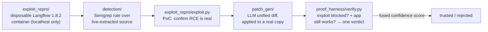

# kavach-loop

**A closed-loop vulnerability remediation pipeline: detect → reproduce the exploit → generate a patch → verify the patch against a proof harness — before any fix is trusted.**

Most "AI fixes your CVE" demos stop at *generating* a patch. kavach-loop refuses to trust a patch until it has proven two things against a **real running instance** of the vulnerable software: (1) the original exploit no longer works, and (2) the app still functions normally. The worked example is a real critical CVE.

> ⚠️ **Scope & safety:** every network-touching module is **hard-locked to localhost** (`127.0.0.1` / `::1`) and refuses any other target. The exploit code exists to prove a patch works against a disposable container you run yourself — not to attack anything. Only run this against the bundled target.

## Worked example: CVE-2026-33017 (Langflow RCE)

Unauthenticated remote code execution in Langflow ≤ 1.8.2 — [GHSA-vwmf-pq79-vjvx](https://github.com/langflow-ai/langflow/security/advisories/GHSA-vwmf-pq79-vjvx) / [NVD](https://nvd.nist.gov/vuln/detail/CVE-2026-33017). `POST /api/v1/build_public_tmp/{flow_id}/flow` builds a *public* flow with no auth; attacker-supplied node `code` reaches `exec()` with no sandbox, through a six-hop call chain from the route handler to the sink.

## The loop



| Stage | Module | What it really does |
|---|---|---|
| **Detect** | `detection/detect.py` + `rules/unauthenticated-exec-sink.yaml` | Runs a **real Semgrep pass** over source pulled live from the target container. The rule honestly flags the *reliably-detectable precondition* (unauthenticated route forwarding attacker-structured input into a downstream call), not full six-hop taint — and says so, at `confidence: LOW`, so every hit still needs confirmation. |
| **Reproduce** | `exploit_repro/exploit.py` | Localhost-only PoC that confirms the RCE actually fires, so we're patching a *real* bug, not a static-analysis guess. |
| **Patch** | `patch_gen/generate.py` | Fetches the real current source of the vulnerable function from the running container, retrieves 1–2 reference fix patterns, asks an LLM for a unified diff, then applies it to a **second disposable container** and restarts it so the patched code reloads. |
| **Verify** | `proof_harness/verify.py` + `test_functionality.py` | Fuses two checks into one verdict: the PoC must now **fail**, *and* Langflow's normal authenticated REST API (health, version, whoami, flow CRUD) must still pass. A patch that blocks the exploit by gutting the app is rejected. |

The honesty is the point: the detection rule documents exactly what it does and doesn't prove, and the verifier refuses to call a patch good just because the exploit stopped working.

## Run it

```bash
pip install -r requirements.txt           # requests, pytest, openai, semgrep
export OPENAI_API_KEY=...                  # for patch_gen

cd exploit_repro/langflow-cve-2026-33017
docker compose up -d                       # vulnerable target on 127.0.0.1:7860
curl -s http://127.0.0.1:7860/health

cd ../..
python detection/detect.py                 # static-analysis finding
python exploit_repro/exploit.py            # confirm the RCE (localhost only)
python patch_gen/generate.py               # generate + apply + verify a patch
pytest proof_harness/                       # functionality smoke tests
```

Stop and wipe: `docker compose down -v`.

## Status
The individual stages (detection, exploit repro, patch gen, proof harness) are implemented and run against the real target. `main.py` is a thin orchestration skeleton — the stages are currently driven directly as shown above. Wiring them into a single `main()` call is the next step.

## Why "kavach"
*Kavach* (कवच) is Sanskrit for "armor." The loop is the armor: nothing ships until it's been attacked and shown to hold.
